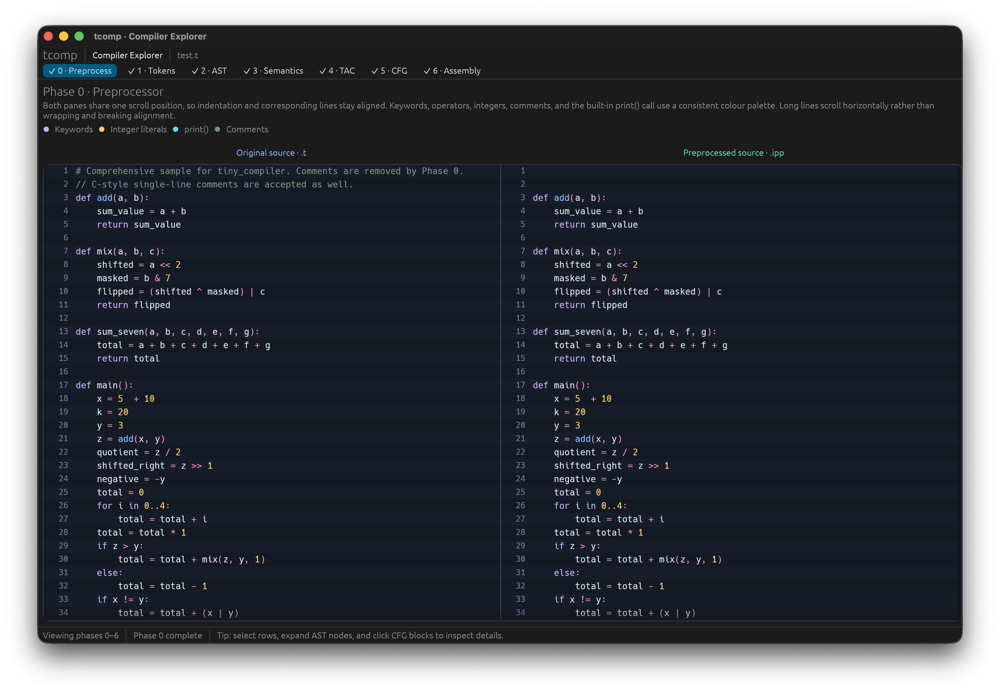
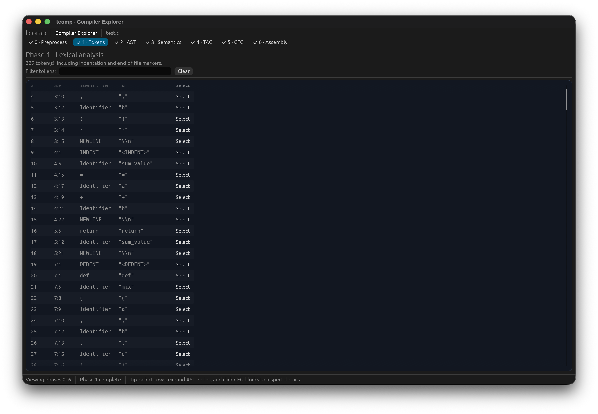
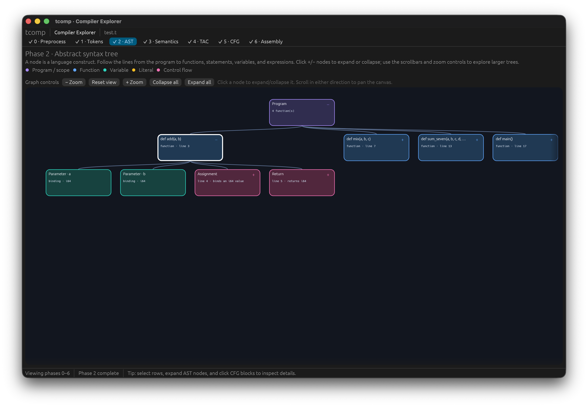
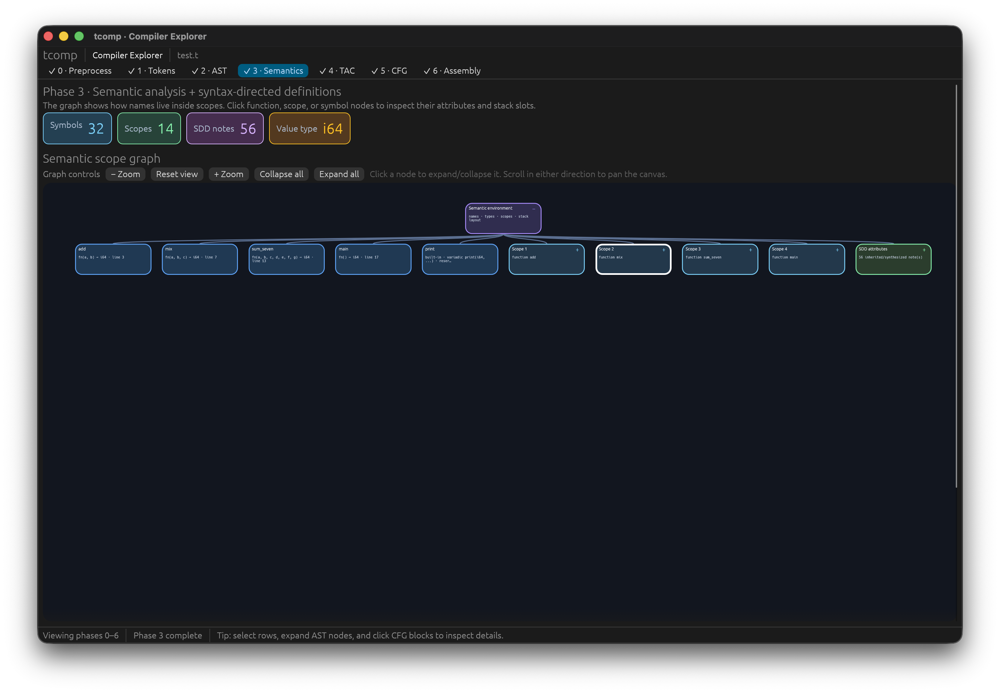
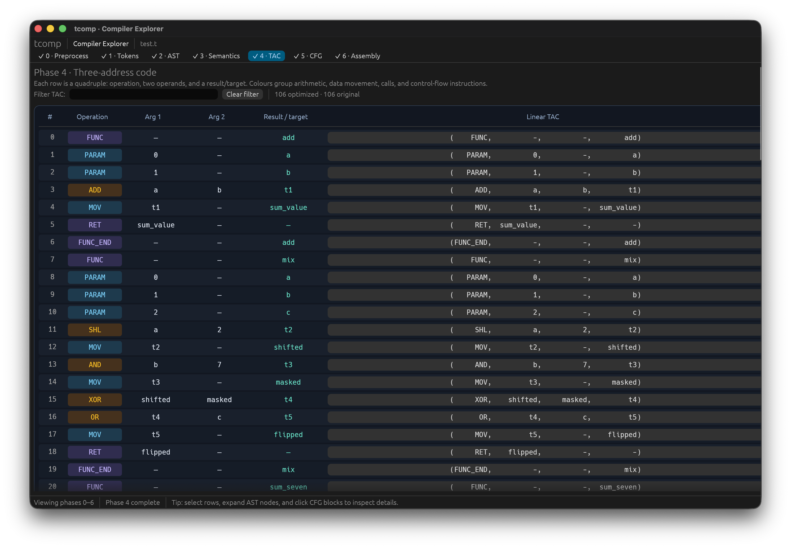
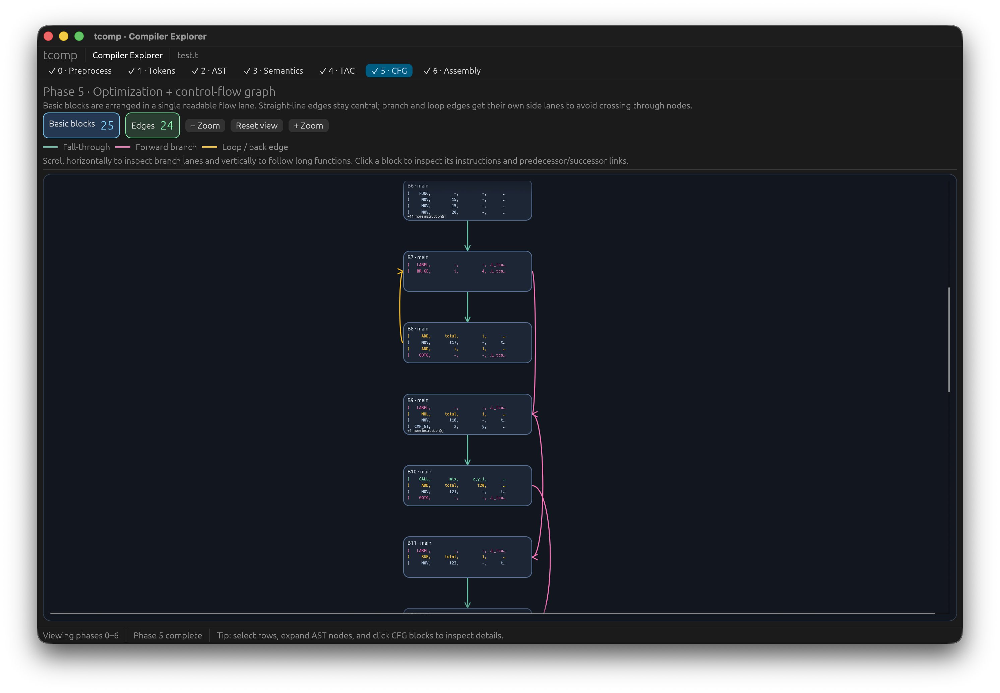
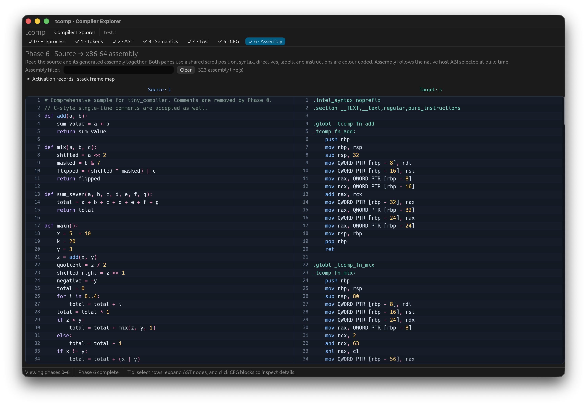

# 🚀 tiny_compiler (`tcomp`) - End-to-End Compiler with Interactive GUI Explorer

[](https://github.com/PrecognitionYash/tiny_compiler/actions/workflows/ci.yml)
[](https://github.com/PrecognitionYash/tiny_compiler/actions/workflows/release.yml)
[](https://opensource.org/licenses/MIT)
[](https://www.rust-lang.org/)
[]()

> **Final Year B.Tech Computer Science & Engineering Capstone Project**  
> *Course:* CS402 - Principles of Complier Design  
> *Project Title:* Design and Implimentation of an Indentation-Sensitive Ahead-of-Time Compiler with Visual Pipeline Inspection  
> *Author:* Yash & Group  
> *Made with:* Rust, MinGW/GCC/Clang, `eframe`/`egui`, and copious amounts of late night chai ☕ and Maggi 🍜  

---

## ⚡ 1. Quick Install & Run (via `curl` - No Rust or Setup Needed!)

You don't even need to clone the repository or install Rust to use `tcomp`. Using `curl` (which is **100% free**, requires **no account**, and is pre-installed on macOS/Linux), you can download and run the compiler in seconds:

### 🍎 For macOS (Apple Silicon M1 / M2 / M3 / M4):
```bash
curl -sL https://github.com/PrecognitionYash/tiny_compiler/releases/latest/download/tcomp-macos-aarch64.tar.gz | tar -xz
chmod +x tcomp
```

### 💻 For macOS (Intel x86_64):
```bash
curl -sL https://github.com/PrecognitionYash/tiny_compiler/releases/latest/download/tcomp-macos-x86_64.tar.gz | tar -xz
chmod +x tcomp
```

### 🐧 For Linux (Ubuntu / Debian x86_64):
```bash
curl -sL https://github.com/PrecognitionYash/tiny_compiler/releases/latest/download/tcomp-linux-x86_64.tar.gz | tar -xz
chmod +x tcomp
```

> **💡 macOS Gatekeeper Tip:**  
> Downloading via `curl` above automatically bypasses Apple's Gatekeeper quarantine warning.  
> However, if you manually downloaded `tcomp` through a browser (Chrome/Safari) and see *"Apple could not verify tcomp"*, simply run this one-line command to remove the quarantine flag:
> ```bash
> xattr -d com.apple.quarantine tcomp
> ```

---

## 📌 2. Project Overview & Motivation

Welcome to **`tiny_compiler`** (binary name: `tcomp`)!  

When we started studying Compiler Design in 6th semester, our textbook (Aho, Lam, Sethi, Ullman - the classic *Dragon Book*) showed lots of theory about DFAs, LL(1)/LR parsers, and Three-Address Code on paper. But we never got to see how a high-level Python-like language actually turns into machine instructions that the CPU can exicute!

Most student compilers stop at generating AST or an interpreter. We wanted to build something that goes all the way from raw source code to **real native x86-64 machine code** (`.exe` on Windows and ELF/Mach-O on Linux/macOS), while also including a **modern interactive GUI Explorer** so our classmates, professors, and juniors can visually inspect what happens at every single phase!

If any error happens in your code, the complier catches it, points out the line and column number, and lets you inspect all previous successful phases in the GUI visualizer.

---

## 🏗️ 3. Complier Pipeline Architechture

Our compiler is divided into **7 clean sequential phases** (Phase 0 to Phase 6). Each phase takes the output of the previous phase and transforms it:

```
    Source (.t file)
          │
          ▼
   ┌───────────────┐
   │    Phase 0    │  ===> Preprocessor (Strips comments, emits .ti file)
   └───────┬───────┘
          │
          ▼
   ┌───────────────┐
   │    Phase 1    │  ===> Lexical Analysis (DFA Tokenizer, INDENT / DEDENT stack)
   └───────┬───────┘
          │
          ▼
   ┌───────────────┐
   │    Phase 2    │  ===> Syntax Analysis (Recursive Descent Parser, Operator Precedence)
   └───────┬───────┘
          │
          ▼
   ┌───────────────┐
   │    Phase 3    │  ===> Semantic Analysis (Scope checking, Symbol Table, SDD/SDT)
   └───────┬───────┘
          │
          ▼
   ┌───────────────┐
   │    Phase 4    │  ===> Intermediate Code Gen (3-Address Code / Quadruples)
   └───────┬───────┘
          │
          ▼
   ┌───────────────┐
   │    Phase 5    │  ===> Code Optmization (Constant Folding & Basic Blocks CFG)
   └───────┬───────┘
          │
          ▼
   ┌───────────────┐
   │    Phase 6    │  ===> Target Code Gen (x86-64 Intel Assembly & Activation Records)
   └───────┬───────┘
          │
          ▼
   Native Linker (GCC / Clang)  ===> Final Executable (./a.out or a.out.exe)
```

---

## 🔍 4. Detailed Phase Breakdown

Here is a quick summary of what each phase does under the hood:

| Phase | Phase Name | What It Does In Code | Interactive Explorer Feature |
|---|---|---|---|
| **0** | **Preprocessor** | Strips `#` and `//` comments without altering character offsets or line numbers. Emits `.ti` preprocessed file. | Side-by-side synchronized view of original `.t` vs preprocessed `.ti` code. |
| **1** | **Lexical Analyzer** | DFA state machine that scans identifiers, numbers, operators, and generates `<INDENT>` and `<DEDENT>` tokens using an indentation stack. | Searchable token table showing token kind, lexeme, line, and column. |
| **2** | **Syntax Parser** | Recursive descent parser using precedence climbing for binary expressions. Emits clean AST nodes. | Interactive AST graph canvas with click-to-expand, collapse, and zoom controls. |
| **3** | **Semantic Checker** | Builds lexical scopes, checks variable declaration before use, verifies function call arity, and computes SDD attributes. | Scope hierarchy tree, symbol table viewer, and SDD card evaluations. |
| **4** | **TAC Generator** | Converts AST to Three-Address Code quadruples (`op`, `arg1`, `arg2`, `result`) using temporaries (`$t1`, `$t2`...). | Full TAC table color-coded by instruction type (arithmetic, branches, calls). |
| **5** | **Optimizer & CFG** | Performs local constant propogation and constant folding. Partitions TAC into Basic Blocks and builds Control Flow Graph. | Visual CFG graph with dedicated routed lanes for loop back-edges and branches. |
| **6** | **Target Codegen** | Emits Intel-syntax x86-64 assembly. Handles System V AMD64 ABI (Linux/Mac) and Microsoft x64 calling convension (Windows). | Side-by-side assembly code and stack frame activation record map. |

---

## 📸 5. Visual Tour of All 7 Compiler Phases

Our GUI is built using `eframe` and `egui` with a dark theme. You can launch it using `./target/release/tcomp test.t -v`. Below are actual screenshots of every phase in action:

<br>

### 🔹 Phase 0: Preprocessor (`test.t` &rarr; `test.ti`)
*Synchronized dual-pane view showing comment removal while retaining exact line offsets for source debugging. Emits clean preprocessed `.ti` output.*



<br>

---

### 🔹 Phase 1: Lexical Analysis & Indentation Stack
*Interactive token stream table generated by our DFA lexer. Notice how Python-style indentation levels are converted into `<INDENT>` and `<DEDENT>` tokens with row and column coordinates.*



<br>

---

### 🔹 Phase 2: Syntax Analysis & Abstract Syntax Tree (AST)
*Expandable tree canvas showing the parsed AST hierarchy. You can zoom in/out, pan, and click any node to expand or inspect its expression parameters and statements.*



<br>

---

### 🔹 Phase 3: Semantic Analysis, Scopes & SDD Evaluator
*Symbol table resolution and Syntax-Directed Definition (SDD) card evaluation. Checks for variable initialization, duplicate names, and scope boundaries.*



<br>

---

### 🔹 Phase 4: Intermediate Code Generation (Three-Address Code TAC)
*Linear representation of instructions as quadruples `(op, arg1, arg2, result)` with temporaries `$t1`, `$t2` and generated branch labels.*



<br>

---

### 🔹 Phase 5: Code Optimization & Control Flow Graph (CFG)
*Constant propagation and folding applied across basic blocks. The graph viewer automatically routes loop back-edges and conditional branch edges through dedicated outer lanes.*



<br>

---

### 🔹 Phase 6: Target Code Generation (x86-64 Assembly & Activation Records)
*Final Intel-syntax assembly generation alongside the compiler's stack frame memory map. Fully compliant with System V AMD64 (Linux/macOS) and Microsoft x64 (Windows) calling conventions.*



<br>

---

## 💻 6. The Source Language (`.t`)

The language is clean, readable, and python-inspired:

- **Indentation-sensitive**: Blocks start with `:` followed by indented lines (no curly brackets `{}`).
- **Comments**: Supports both `# python style` and `// c style` comments.
- **Data Types**: All variables and expressions are signed 64-bit intergers (`i64`).
- **Functions**: Defined with `def name(arg1, arg2):` and exit with `return expr`. Every program must have an entry point `def main():`.
- **Loops & Conditions**: `for i in start..end:` (exclusive range) and `if expr:` / `else:`.
- **Operators**: Full bitwise support (`|`, `^`, `&`, `<<`, `>>`), relational (`==`, `!=`, `<`, `<=`, `>`, `>=`), and arithmetic (`+`, `-`, `*`, `/`, unary `-`).
- **Built-in `print(...)`**: Prints multiple expressions separated by spaces with newline at end (e.g. `print(x, y + 2, 42)`).

### Example Program (`test.t`):

```python
# Function to add two numbers
def add(a, b):
    sum_value = a + b
    return sum_value

# Function with bitwise operations
def mix(a, b, c):
    shifted = a << 2
    masked = b & 7
    flipped = (shifted ^ masked) | c
    return flipped

# Function testing 7 arguments (spills to stack)
def sum_seven(a, b, c, d, e, f, g):
    total = a + b + c + d + e + f + g
    return total

def main():
    x = 15
    y = 3
    z = add(x, y)
    quotient = z / 2
    shifted_right = z >> 1
    
    total = 0
    for i in 0..4:
        total = total + i
        
    if z > y:
        total = total + mix(z, y, 1)
    else:
        total = total - 1
        
    stack_test = sum_seven(1, 2, 3, 4, 5, 6, 7)
    print(x, y, z, quotient, shifted_right, total, stack_test)
    return 0
```

---

## ⚙️ 7. System Requirements & Prerequisites (For Building from Source)

Before compiling or running `tcomp` from source, make sure you have:

1. **Rust Toolchain**: Stable Rust and Cargo (version 1.80+ recommended).  
   Install via: `curl --proto '=https' --tlsv1.2 -sSf https://sh.rustup.rs | sh`

2. **Native Assembler/Linker Toolchain**:
   - **macOS:** Xcode Command Line Tools:
     ```sh
     xcode-select --install
     ```
   - **Linux (Ubuntu/Debian):** GCC, Clang, and GUI development libraries:
     ```sh
     sudo apt-get update
     sudo apt-get install -y build-essential gcc clang libxcb-render0-dev libxcb-shape0-dev libxcb-xfixes0-dev libxkbcommon-dev libgl1-mesa-dev libfontconfig1-dev
     ```
   - **Windows:** 64-bit MinGW-w64 GCC (make sure `gcc.exe` is added to your system `PATH`).  
     *Note:* MSVC's `cl.exe` will not work because `tcomp` generates GNU/Intel-syntax assembly designed to be linked with GCC/Clang.

---

## 🛠️ 8. How to Build & Run from Source

### Step 1: Clone the Repository
```sh
git clone https://github.com/PrecognitionYash/tiny_compiler.git
cd tiny_compiler
```

### Step 2: Build the Compiler
```sh
cargo build --release
```
The compiled binary will be located at `target/release/tcomp` (`target\release\tcomp.exe` on Windows).

### Step 3: Run Compiler CLI

#### A) Compile directly to native executable:
```sh
# On macOS / Linux:
./target/release/tcomp test.t -o myprogram
./myprogram
# Outputs: 15 3 18 9 9 105 28

# On Windows (PowerShell):
.\target\release\tcomp.exe test.t -o myprogram.exe
.\myprogram.exe
```

#### B) Stop at Preprocessing (Phase 0 output):
```sh
./target/release/tcomp test.t -E
# Generates test.ti with comments stripped
```

#### C) Stop at Assembly Generation (Phase 6 output):
```sh
./target/release/tcomp test.t -S
# Generates test.s (inspect native x86-64 assembly!)
```

#### D) Launch the Interactive Visualizer GUI:
```sh
# Open GUI displaying all 7 phases:
./target/release/tcomp test.t -v

# Or open specific phases (e.g. Phase 0 to Phase 2):
./target/release/tcomp test.t -v 0..2
```

---

## 🧪 9. Testing & Quality Checks

We have set up full linting and checks to maintain clean code standards:

```sh
# 1. Check syntax without building
cargo check

# 2. Check code formatting
cargo fmt --check

# 3. Run Clippy linter with strict warnings
cargo clippy --all-targets -- -D warnings

# 4. Run test suite
cargo test
```

---

## 🤖 10. CI/CD Release Pipeline

We have automated CI/CD using GitHub Actions located in `.github/workflows/`:

1. **`ci.yml`**: Runs on every pull request and push to `main`. It automatically checks `cargo fmt`, `cargo clippy`, `cargo test`, and `cargo build` on Ubuntu, macOS, and Windows.
2. **`release.yml`**: Automatically triggers when you push a new version tag (like `v0.1.0`) or trigger it manually from GitHub Actions tab. It builds independent release packages for each OS:
   - `tcomp-linux-x86_64.tar.gz` (Linux ELF)
   - `tcomp-windows-x86_64.zip` (Windows PE)
   - `tcomp-macos-x86_64.tar.gz` (macOS Intel)
   - `tcomp-macos-aarch64.tar.gz` (macOS Apple Silicon)
   - `SHA256SUMS.txt` for security verification.

---

## 🚀 11. How to Upload This Project to GitHub

If you are uploading this project to your GitHub account for the first time, follow these exact commands in your terminal:

```sh
# 1. Navigate to the project root
cd /Users/yash/RustRoverProjects/Learning/RustNormal/tiny_compiler

# 2. Initalize git repository (if not already done)
git init

# 3. Add all files (the .gitignore will ignore target/ and temp files automatically)
git add .

# 4. Make your commit
git commit -m "feat: complete compiler with GUI screenshots, CI/CD pipeline, and docs"

# 5. Rename branch to main
git branch -M main

# 6. Add your GitHub remote repository
git remote add origin https://github.com/PrecognitionYash/tiny_compiler.git

# 7. Push code to GitHub
git push -u origin main

# 8. (Optional) Create and push a release tag to trigger the automatic CI/CD release workflow:
git tag v0.1.0
git push origin v0.1.0
```

Once pushed, go to your GitHub repository:
- Check the **Actions** tab to see your CI/CD pipeline building across Windows, Linux, and macOS.
- Check the **Releases** tab to download pre-compiled binaries for each OS!

---

## 👥 12. Contributors & Acknowledgements

- **Developer:** Yash & CSE Project Group
- **Guidance:** Department of Computer Science & Engineering
- **References:**
  - `egui` and `eframe` by Emil Ernerfeldt
  - Rust Documentation and Compiler WG

---

## 📄 License

This project is open-source and licensed under the [MIT License](LICENSE). Feel free to use it for educational purposes, project submissions, or learning compiler engineering!
